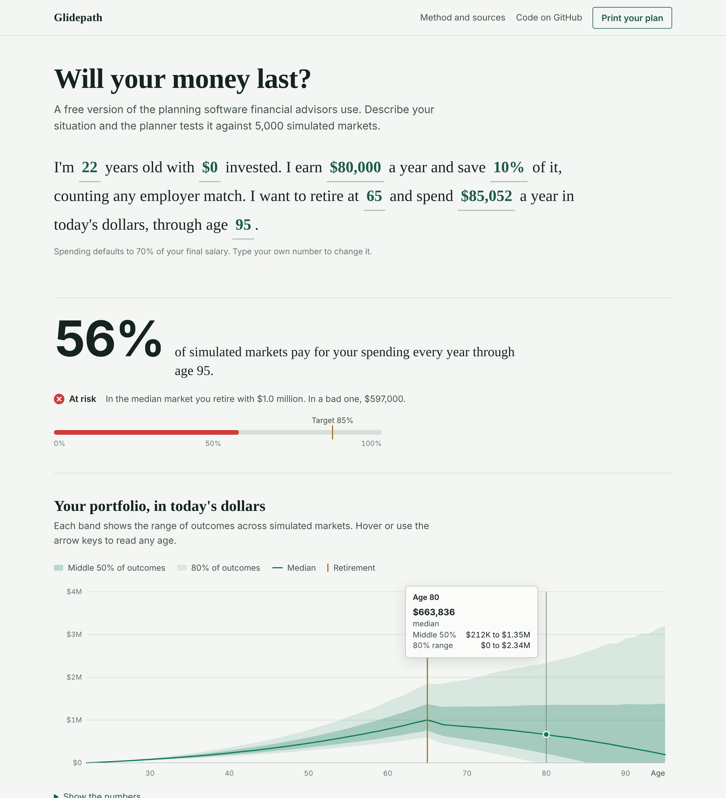
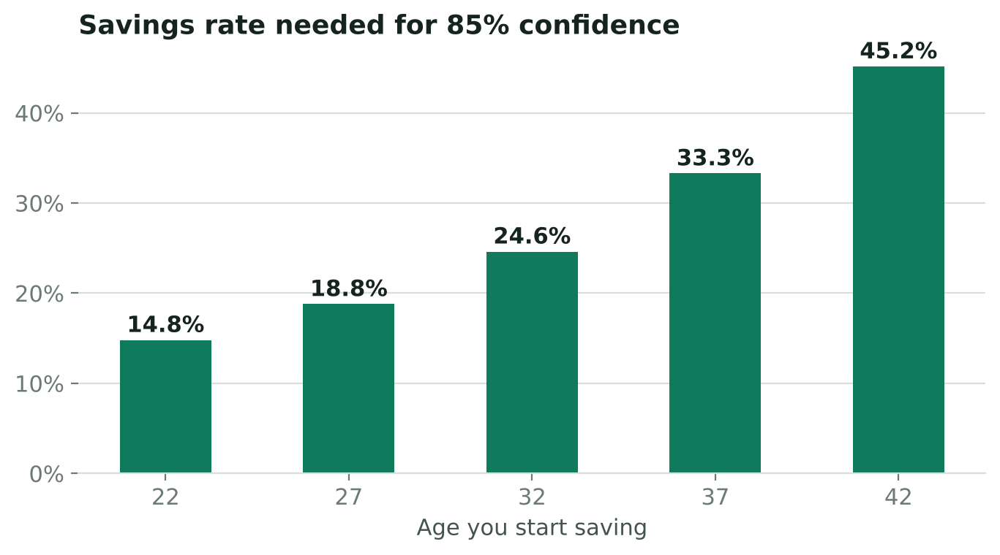
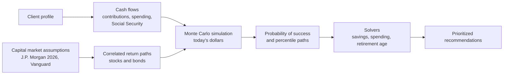

# Glidepath

*Named for the glide path, the schedule that shifts a portfolio from stocks toward bonds as retirement approaches.*

**A free, open-source version of the Monte Carlo planning software financial advisors charge for.**
Describe your situation in one sentence and the planner tests it against thousands of simulated
markets, then solves for the savings rate, spending level or retirement age that gets you to 85%
confidence.

**[Try the live planner](https://saricgandhi-web.github.io/glidepath/)** ·
[Case study](docs/CASE_STUDY.md) · [Methodology](docs/METHODOLOGY.md)

[](https://github.com/saricgandhi-web/glidepath/actions/workflows/ci.yml)




## The problem

Retirement planning advice is expensive and unevenly distributed:

- About **34%** of Americans work with a financial advisor, versus **74%** of millionaires
  (Northwestern Mutual, *Planning & Progress Study 2025*).
- The median advisor fee is **1% of assets per year** on portfolios up to $1M, and the all-in cost
  including fund expenses averages about **1.65%** (Kitces Research 2024; Inside Information).
- **39%** of working-age households are at risk of being unable to maintain their living standard in
  retirement (Center for Retirement Research at Boston College, *National Retirement Risk Index*).

The heart of a financial plan is a computation: given my savings, income and goals, how likely am I to
run out of money, and what should I change? That computation should be free, transparent and checkable.

## What I built

| | |
|---|---|
| **Planning engine** (Python, NumPy) | Vectorized Monte Carlo simulation of a client's full life cycle: contributions, a stock/bond glide path, fees, inflation, Social Security and retirement withdrawals. |
| **Goal-seek solvers** | Bisection on common random numbers finds the exact savings rate, sustainable spending and earliest retirement age for a target probability of success. |
| **Social Security estimator** | The SSA's 90/32/15 PIA formula with bend points, taxable maximum, 35-year averaging and early/delayed claiming adjustments, plus a trust-fund depletion stress test. |
| **Interactive web app** (vanilla JS) | A browser port of the engine with a fan chart, live levers, fee comparison and a printable client report. No frameworks, no tracking, no network requests. |
| **Case study** | A consulting-style analysis of three hypothetical clients with four quantified findings. Every number regenerates from one script. |
| **Verification** | 30 Python unit tests against closed-form results, plus parity tests proving the JavaScript engine reproduces the Python engine. CI runs on every push. |

## Key findings

From the [case study](docs/CASE_STUDY.md) (10,000 simulations per scenario, today's dollars):

1. **Starting early is the cheapest lever.** For the same retirement goal, a saver starting at 22 needs
   to save 14.8% of income for 85% confidence. Starting at 32 requires 24.6%; at 42, 45.2%.
2. **Fees compound against you.** A 1.65% all-in cost lowers a 35-year-old's median wealth at retirement
   by about $325,000 versus 0.05% index funds, and drops the chance of success from 38% to 7%.
3. **Plan on the cautious outlook.** Switching from J.P. Morgan's to Vanguard's capital market
   assumptions cuts a new grad's success rate from 60% to 29%.
4. **Social Security timing is a planning decision.** For a client retiring at 62, delaying the claim to
   70 raises success from 47% to 57%. A benefit cut to 83% in 2034 lowers it to 44%.



## How it works



Each year, stock and bond returns are drawn from correlated lognormal distributions whose median
equals the forecast compound return and whose standard deviation equals the forecast volatility.
The portfolio de-risks along a glide path, fees come out of each year's return, and everything is
deflated to today's dollars. A scenario succeeds if every year of retirement spending is paid in full.
Details and formulas are in [METHODOLOGY.md](docs/METHODOLOGY.md).

All assumptions live in one file, [`planner/data/assumptions.json`](planner/data/assumptions.json),
with a source for every number. The Python engine and the web app both read it.

## Quick start

Requires Python 3.10+ and NumPy.

```bash
git clone https://github.com/saricgandhi-web/glidepath.git
cd glidepath
pip install -r requirements.txt

# A plan from the command line
python -m planner --age 30 --income 95000 --savings 40000 --rate 0.12

# Same client, paying a 1% advisor and stress-testing Social Security
python -m planner --age 30 --income 95000 --savings 40000 --rate 0.12 --fee 0.01 --fund-fee 0.0065 --haircut
```

Use it as a library:

```python
from planner import PlanInputs, build_plan, format_plan

client = PlanInputs(current_age=30, annual_income=95_000, current_savings=40_000, savings_rate=0.12)
print(format_plan(build_plan(client)))
```

Run the web app locally:

```bash
python scripts/build_site.py          # bundles web/ into _site/index.html
python -m http.server -d _site 8000   # open http://localhost:8000
```

Reproduce the case study and run the tests:

```bash
pip install -r requirements-dev.txt
python analysis/case_study.py         # regenerates docs/CASE_STUDY.md, charts and results.json
pytest                                # Python tests
npm test                              # JavaScript parity tests (Node 20+, no dependencies)
```

## Project structure

```
planner/                 Python planning engine
  model.py               Monte Carlo simulation and plan inputs
  solvers.py             savings rate, spending and retirement-age solvers
  social_security.py     SSA benefit formula and claiming adjustments
  fees.py                fee drag analysis
  report.py              prioritized recommendations
  data/assumptions.json  every assumption, with sources
web/                     browser app (engine.js mirrors the Python engine)
analysis/case_study.py   generates the case study, charts and results
tests/                   unit tests and Python/JavaScript parity tests
scripts/                 site bundler and parity fixture generator
.github/workflows/       CI and GitHub Pages deployment
```

## Privacy and security

- The web app runs entirely in the browser. Nothing a visitor types is sent anywhere or stored.
- The page ships with a strict Content Security Policy that blocks all network requests.
- The repository contains no API keys, credentials or personal data, and needs none to run.
- GitHub Actions are pinned to exact commit SHAs, and Dependabot keeps them up to date.

## Roadmap

- Tax-aware modeling: Roth vs. traditional contributions and asset location
- Flexible spending rules (guardrails) in retirement
- Historical bootstrap returns as an alternative to parametric assumptions
- Couples, pensions and one-off goals such as a home purchase

## Disclaimer

For education only. This is not investment, tax or legal advice. Projected returns are estimates and
do not guarantee future results.

## License

[MIT](LICENSE).
