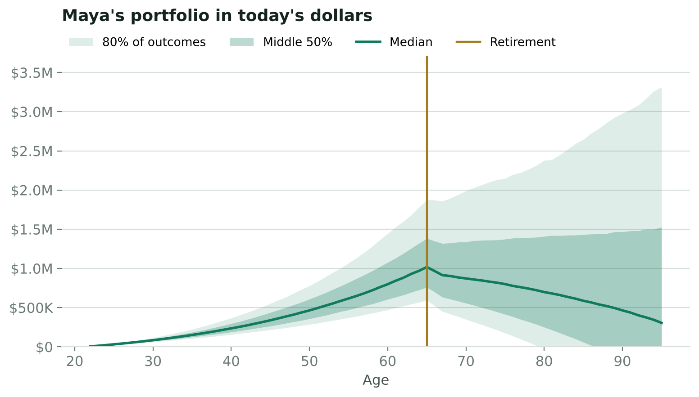
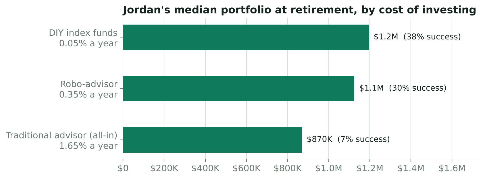
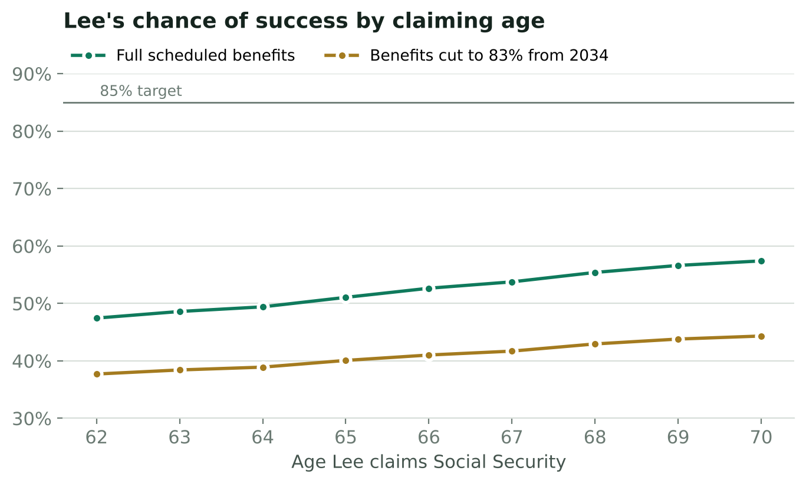

# Case study: closing the retirement advice gap

*Every number in this document is produced by `python analysis/case_study.py` (10,000
simulations per scenario, assumptions as of 2026-10-16). Clients are hypothetical.
Dollar figures are in today's dollars.*

## The problem

Most Americans plan for retirement without professional help. Only about a third of the general
population works with a financial advisor, compared with roughly three quarters of millionaires
(Northwestern Mutual, *Planning & Progress Study 2025*). The gap is partly price: the median advisor
charges about 1% of assets a year on portfolios up to $1 million, and a standalone comprehensive plan
typically costs a few thousand dollars (Kitces Research, 2024). Meanwhile, the Center for Retirement
Research at Boston College estimates that 39% of working-age households are at risk of not maintaining
their standard of living in retirement (*National Retirement Risk Index*, 2022 SCF update).

The core deliverable an advisor provides, a probability-based plan with clear levers, is a computation.
This project makes that computation free, transparent and reproducible.

## The approach

1. **Model the client.** Income, savings, spending goal, Social Security (estimated with the SSA benefit
   formula) and a stock/bond glide path.
2. **Simulate markets.** Correlated lognormal stock and bond returns calibrated to J.P. Morgan's 2026
   Long-Term Capital Market Assumptions, with Vanguard's more cautious outlook as a stress case.
3. **Score the plan.** Probability that every year of retirement spending is fully funded.
4. **Solve for the levers.** Bisection finds the exact savings rate, spending level or retirement age that
   reaches 85% confidence.
5. **Prioritize.** Rank recommendations by how much they change the outcome.

## Three clients

| | Maya, 22 | Jordan, 35 | Lee, 52 |
|---|---|---|---|
| Situation | New grad, $78,000 salary, saves 10% | $120,000 salary, uses a traditional advisor (1.65% all-in) | $650,000 saved, wants to retire at 62 |
| Chance of success | **60%** | **7%** | **54%** |
| Median at retirement | $1,017,250 | $869,838 | $1,232,575 |
| Savings rate for 85% | 14.6% | 40.1% | 36.0% |
| Sustainable spending at 85% | $68,673/yr | $66,285/yr | $79,275/yr |

## Findings

### 1. Starting early is the cheapest lever

Holding the same spending goal ($82,926/yr), a saver who starts at 22
with nothing saved needs to set aside 14.8% of income to reach 85% confidence. Waiting until
32 raises that to 24.6%, and starting at 42 requires 45.2%.

### 2. Fees compound against you

For Jordan, a 1.65% all-in cost leaves a median $869,838 at
retirement versus $1,195,018 with 0.05% index funds, a difference of
$325,180. The chance of success moves from 38% to
7%. As a rule of thumb, a steady saver earning 5% a year gives up about
23% of ending wealth to a 1% annual fee over 40 years.

Advice can be worth its cost when it changes behavior (saving more, staying invested in a downturn,
better tax decisions). Know the price, then weigh it against what the advice changes.

### 3. The market outlook matters, so plan on the cautious one

Under the base-case assumptions Maya's plan succeeds 60% of the time. Under Vanguard's
more cautious outlook it succeeds 29% of the time, and the savings rate she needs rises from
14.6% to 21.1%.

### 4. Social Security timing is a planning decision

Lee retires at 62. Claiming at 62 brings in $33,655/yr, waiting until 70 brings in
$59,618/yr. The best claiming age for this plan is 70
(57% success). If benefits are cut to 83% when the trust funds are projected to run out in
2034 (2026 Trustees Report), success at that age falls to 44%.

## Recommendations

1. **Automate saving early, and raise the rate with each raise.** It is the lever with the biggest effect
   for the least lifestyle change.
2. **Audit total cost, not just the advisory fee.** Add fund expense ratios to the advisory fee and compare
   the result with what the advice changes.
3. **Stress-test with conservative assumptions** and a Social Security haircut before committing to a
   retirement date.
4. **Treat the claiming age as part of the plan.** Model it alongside the retirement age instead of
   deciding it separately.

## Limits

Taxes, account location, pensions, home equity, health-care shocks and dynamic spending rules are not
modeled. Returns are drawn independently each year (no momentum or mean reversion). These are natural
next steps; see the README roadmap.

## Sources

- J.P. Morgan Asset Management, *2026 Long-Term Capital Market Assumptions* (data as of 2025-09-30).
- Vanguard, *Vanguard Capital Markets Model* forecasts (June 30, 2026 run) and *2026 Economic and Market Outlook*.
- Kitces Research, *How Financial Planners Actually Do Financial Planning* (2024); Bob Veres, *Inside Information* fee study.
- Northwestern Mutual, *Planning & Progress Study 2025*.
- Center for Retirement Research at Boston College, *The National Retirement Risk Index: An Update from the 2022 SCF*.
- Social Security Administration, 2026 Trustees Report and 2027 benefit formula.
- IRS, 2026 retirement plan contribution limits.
- Morningstar, *The State of Retirement Income* (December 2025).
